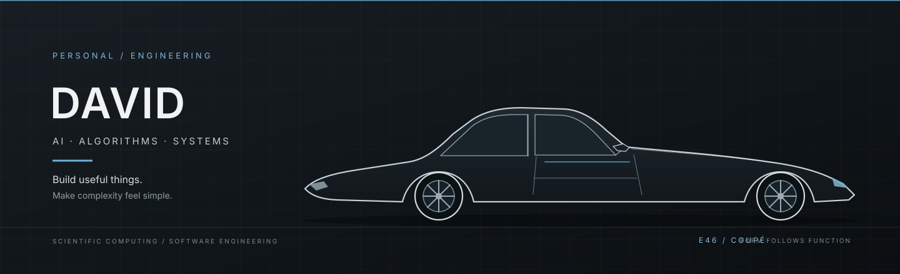

  
  
<strong>AI · ALGORITHMS · SYSTEMS</strong>

  
Building useful software at the intersection of intelligent systems and scientific computing.

  
<a href="https://github.com/nkfff">GitHub</a> &nbsp;·&nbsp; <a href="mailto:1395598907@qq.com">Email</a>

---

### About

I'm David — an engineer working across **AI agents, algorithm design, and high-performance software**. I enjoy turning complex ideas into tools that are useful, reliable, and fast.

### Selected work

- **[ClusterBridge](https://github.com/nkfff/ClusterBridge)** — A lightweight SSH relay for cross-cluster file transfers, streaming data through bounded memory.
- **[MicroEnvForge](https://github.com/nkfff/MicroEnvForge)** — A modular framework for tumor microenvironment scoring.
- **[SpatialMETA](https://github.com/nkfff/SpatialMETA)** — A spatial multi-omics toolkit; this fork focuses on smoother, more reproducible installation.

### Toolkit

`Python` · `C++` · `R` · `PyTorch` · `Linux` · `CUDA` · `Slurm` · `Docker`

  Built with curiosity. Designed with intent.

